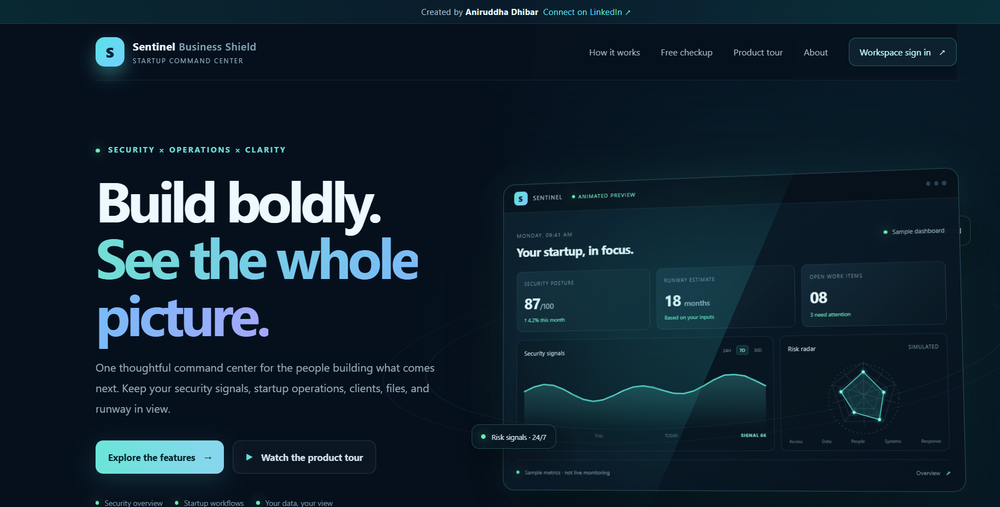
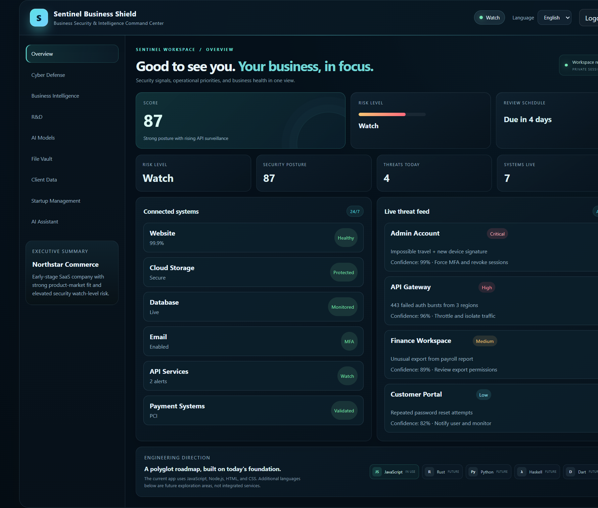
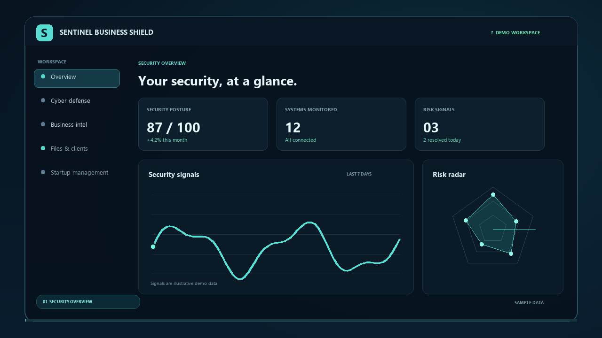
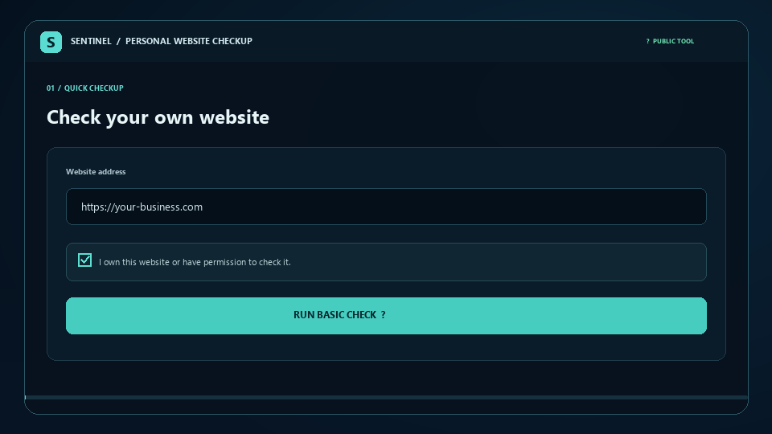

<div align="center">

# Sentinel Business Shield

### A focused command center for startup security signals and business operations.

Manage client records, review security indicators, organize files, track startup work, and estimate financial runway in one locally runnable web application.

[](https://nodejs.org/)
[](https://expressjs.com/)
[](https://developer.mozilla.org/docs/Web/JavaScript)
[](https://www.rust-lang.org/)
[](https://www.python.org/)
[](https://dart.dev/)
[](./package.json)

[**Run locally:** http://localhost:3000](#run-locally) · [Open the workspace: http://localhost:3000/workspace](#run-locally)

[Explore the features](#features) · [Run locally](#run-locally) · [Technology stack](#technology-stack) · [Security notes](#security-and-deployment)

</div>

## Interface previews

| Public website | Private workspace dashboard · sample data |
| --- | --- |
|  |  |

## Project videos

Select a preview image to open its locally hosted MP4:

| Product tour | Public website checkup |
| --- | --- |
| [](./public/sentinel-demo.mp4) | [](./public/website-checkup-demo.mp4) |

## Features

- **Public product site** — responsive landing page, product information, locally served team photography, animated interface previews, and short demo videos.
- **Private workspace** — sign-in protects dashboard and business-data routes; self-registration is available only in local development.
- **Production access controls** — public account registration is disabled in production; workspace admins provision team accounts. Login and registration attempts are rate-limited.
- **Startup operations** — manage clients, CSV-backed file records, team tasks, business indicators, and financial runway estimates.
- **Encrypted storage** — JSON workspace records and uploaded CSV files are encrypted with AES-256-GCM before being written to disk; legacy plaintext data is migrated on startup.
- **Public website checkup** — an owner-authorized, single-request HTTP(S) availability and response-header check. It does not crawl, scan ports, follow redirects, or perform a penetration test.
- **Private CSV summary** — analyze a CSV in the browser to count records and identify email/company totals and row completeness. Input stays in the browser; maximum file size is 5 MB and maximum data rows is 100,000.
- **Optional AI assistant** — connect an OpenAI-compatible provider through server-side environment configuration.
- **Polyglot companion tools** — standalone Rust and Python CSV utilities and a Dart health-check client complement the Node.js web app; Haskell remains an exploration item.

## Technology stack

### Languages and formats

| Language / format | Usage |
| --- | --- |
| **JavaScript (ES2022+)** | Express server and interactive browser application |
| **HTML5** | Semantic page structure and accessible forms |
| **CSS3** | Responsive layout, visual design, and animations |
| **Rust** | Standalone CSV structure and formula-risk auditor |
| **Python 3** | Standalone local CSV client-summary utility |
| **Dart 3** | Standalone bounded-time HTTP health-check client |
| **JSON** | Application configuration and local development data |
| **PowerShell** | Windows setup and command examples |
| **Markdown** | Project and developer documentation |

### Companion tools

Rust, Python, and Dart tools are real, runnable source code in `tools/`. They run independently on your computer; they are **not** required by or launched as services in the Node.js web app or Render deployment.

#### Rust CSV auditor

Checks CSV quoting and row structure, counts formula-like cells for review, and enforces a 5 MiB / 100,000-row limit. It never uploads or edits the source file.

```powershell
cargo test --manifest-path tools\rust-csv-audit\Cargo.toml
cargo run --manifest-path tools\rust-csv-audit\Cargo.toml -- .\clients.csv
```

#### Python client CSV summary

Counts client rows, unique email contacts and companies, and complete rows. It uses Python's standard library and prints aggregate counts, not client-cell values.

```powershell
python tools\python-csv-summary\csv_summary.py .\clients.csv
python -m unittest discover -s tools\python-csv-summary -p "test_*.py"
```

#### Dart health-check client

Requests the app's `/api/health` endpoint with a timeout, no redirect following, and a response-size limit. It is an unauthenticated service-health request; only check a server you operate or are authorized to contact.

```powershell
Set-Location tools\dart-health-client
dart run bin\health_check.dart http://localhost:3000
```

### Web application runtime and libraries

- **Node.js 20+** with **Express 5**
- `express-session` for session-based authentication
- `bcryptjs` for password hashing
- `helmet` for HTTP security headers
- `express-rate-limit` for request rate limiting
- `multer` for CSV upload handling

## Run locally

### Requirements

- Node.js 20 or later
- npm

### Start the application

From the project directory, run:

```powershell
npm install
npm start
```

Once the server reports that it is running, open [http://localhost:3000](http://localhost:3000) in a browser on the same computer. The private workspace is at [http://localhost:3000/workspace](http://localhost:3000/workspace).

**Localhost is not a public website link.** It only works on the computer running this app after you run `npm start`; clicking a localhost address on GitHub will not start the server or open the hosted project for other people.

The app creates encrypted JSON data, an upload directory, and a local data-encryption key under `data/` on first run. Preserve the key with the data; without it, encrypted records cannot be recovered. For local development only, default demo accounts are created when no user database exists:

| Email | Password |
| --- | --- |
| `admin@northstar.com` | `Shield@2026!` |
| `ops@northstar.com` | `Ops@2026!` |

These are development credentials, not production credentials. Replace them before using real business data. Runtime data and uploaded files are excluded from Git.

### Development mode

```powershell
npm run dev
```

### Run checks

```powershell
npm test
```

`npm test` includes server/client JavaScript syntax checks and regression tests for encrypted storage, CSV handling, safe exports, authentication safeguards, and role-based write permissions. `npm audit` checks dependencies for known vulnerabilities.

## Deploy to Render

This repository includes a [`render.yaml`](./render.yaml) Blueprint configuration. It creates a Node.js web service with a 1 GB persistent disk mounted at `/var/data`, so account data, client records, application settings, and uploaded files survive service restarts and redeploys. The Blueprint uses Render's paid Starter service plan because persistent disks are not available on Free web services; check Render's current pricing before deploying.

1. Push the project to a GitHub repository.
2. In the [Render Dashboard](https://dashboard.render.com/), choose **New → Blueprint** and connect the repository.
3. Before the first deploy, provide the prompted values for `INITIAL_ADMIN_NAME`, `INITIAL_ADMIN_EMAIL`, and `INITIAL_ADMIN_PASSWORD`. Use an email you control and a unique password with at least 12 characters. The admin account is created once in the persistent disk; keep these values safe.
4. Review the Blueprint configuration and deploy. Render generates separate `SESSION_SECRET` and `DATA_ENCRYPTION_KEY` values; the service uses HTTPS, trusts Render's proxy, and checks `/api/health`.
5. After deployment, Render provides a public `onrender.com` service URL. Open that URL and sign in at `/workspace`. Share that deployed URL—not a localhost address—with other people.

The local `data/` directory remains the default when `DATA_DIR` is unset; Render sets `DATA_DIR=/var/data` to use its persistent disk. Keep the disk attached and do not change its mount path if you want to retain existing application data. Keep `DATA_ENCRYPTION_KEY` backed up in a secure password manager or secret manager; losing or rotating it without re-encrypting the data makes stored records and files unrecoverable. Back up the data disk and key separately, and test restoring them before entering important records.

The configured service is intended for a **single small workspace on one running instance**. Sessions use Express's in-memory store, so all users will need to sign in again after a restart; do not scale to multiple instances. Production registration is disabled to prevent arbitrary sign-ups from viewing shared workspace records. An admin can create an `ops`, `analyst`, or `viewer` account through the authenticated `POST /api/admin/users` endpoint. Public sign-up remains available for local development.

**If you already created a Web Service manually**, pushing a change to `render.yaml` does not automatically add its environment variables. In that service's **Environment** settings, add `NODE_ENV=production`, `TRUST_PROXY=1`, `DATA_DIR=/var/data`, a unique `SESSION_SECRET` (at least 32 bytes), a separate `DATA_ENCRYPTION_KEY` (at least 32 bytes), and the initial admin email/password when creating a fresh data disk. Attach a persistent disk at `/var/data`. Generate secrets in Render, keep them private, and preserve the encryption key and disk across deploys. Alternatively, create/manage the service as a Blueprint so Render applies the values in `render.yaml`. Never replace the production secret checks with hard-coded fallback values.

## Optional AI assistant

The assistant requires an API key from an OpenAI-compatible provider. Configure these environment variables in your shell or hosting provider. The `.env.example` file is a reference template and is not automatically loaded:

| Variable | Purpose |
| --- | --- |
| `AI_API_KEY` | Provider secret; kept on the server |
| `AI_MODEL` | Optional model name; defaults to `gpt-4o-mini` |
| `AI_API_URL` | Optional compatible chat completions URL; defaults to OpenAI |

PowerShell example:

```powershell
$env:AI_API_KEY = "your-provider-key"
$env:AI_MODEL = "gpt-4o-mini"
npm start
```

Without `AI_API_KEY`, other features remain available and the assistant displays a configuration message. Chat messages are sent to the configured provider and are not stored by this app. Do not send passwords, API keys, or sensitive client data.

## Security and deployment

The public website checkup is intentionally limited to one HTTP(S) request to a public domain on its standard port, after the visitor confirms authorization. It rejects private/non-public destinations, does not follow redirects, and is rate-limited to six requests per client IP per 15 minutes. Its response-header observations are informational, not a vulnerability assessment or a security audit. Public CSV analysis happens in the visitor's browser and does not upload the selected CSV.

Production deployment configuration:

1. Set `NODE_ENV=production` and configure `SESSION_SECRET` to a unique, randomly generated value.
2. Set `DATA_ENCRYPTION_KEY` to a separate, unique random secret of at least 32 bytes. Keep it stable and backed up separately from the data disk.
3. On the first start with no existing users, set `INITIAL_ADMIN_EMAIL` and a unique `INITIAL_ADMIN_PASSWORD` of 12–72 bytes. `INITIAL_ADMIN_NAME` is optional. Team passwords must also be 12–72 bytes.
4. Serve the app over HTTPS. If it is behind a trusted TLS-terminating reverse proxy, set `TRUST_PROXY=1`.

Workspace JSON files and CSV uploads are authenticated and encrypted at rest using AES-256-GCM. The encryption key is not stored alongside production data. Plaintext local JSON and uploaded CSVs are encrypted the first time the app starts after this upgrade. A persistent disk is not a backup; configure automatic backups, monitoring, an incident-response process, and restore tests. The app is a single-workspace product and does not provide tenant isolation, MFA, SSO, account recovery, or compliance certification. Have a qualified security/privacy professional review it before storing regulated, highly sensitive, or legally restricted data. The runway calculator is an estimate based solely on user-entered values and is not financial advice.

A custom company-domain sign-in URL requires a domain you control, DNS pointed at a hosting provider, and an HTTPS deployment. The local `/workspace` address is not publicly reachable.

## Project information

- **Creator:** Aniruddha Dhibar
- **License:** ISC — see [`package.json`](./package.json)
- **Local preview:** `http://localhost:3000` (available only while the app is running on your computer)
- **Public deployment:** Deploy with Render using the steps above; Render provides the public URL after deployment.
